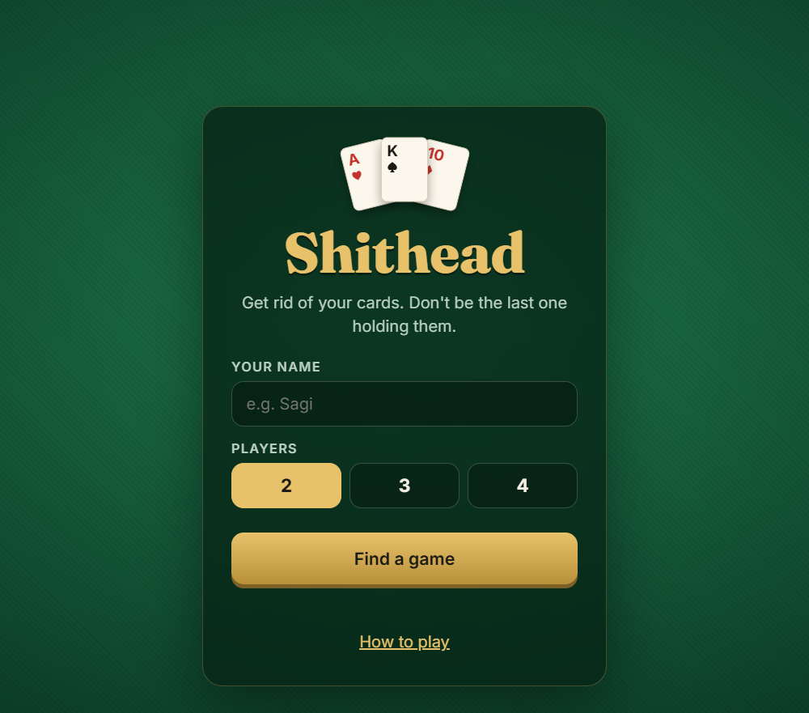
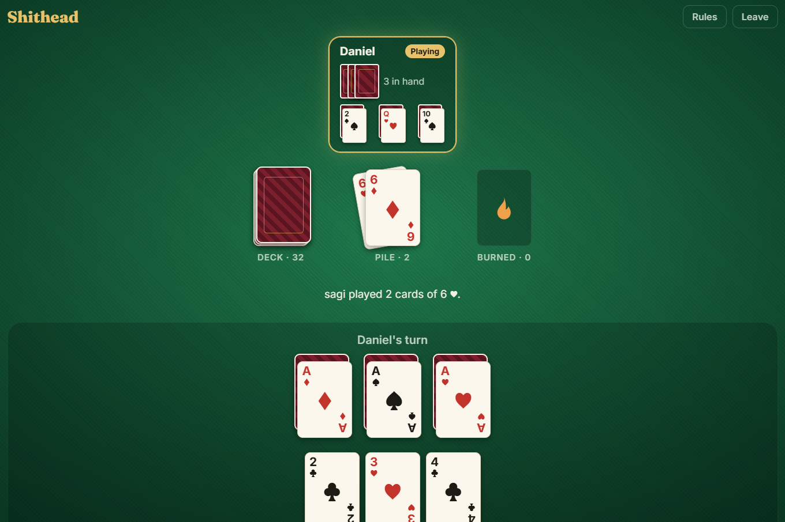
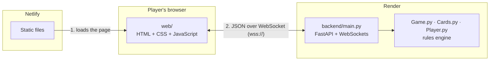

# 🃏 Shithead — Multiplayer Card Game

**A real-time multiplayer card game for 2–4 players. Play it in your browser, no install needed.**

### ▶️ [Play now: shited-game.netlify.app](https://shited-game.netlify.app)


<p align="center">
  
  &nbsp;
  
</p>

> **Note:** the backend runs on Render's free tier and sleeps when nobody is playing.
> The first visit after a quiet period can take about 50 seconds to connect.

---

## ✨ Features

- **Online multiplayer:** open the link, enter a name, pick 2, 3 or 4 players, and you're matched automatically.
- **Real-time:** every move appears instantly for all players over WebSockets.
- **Fair by design:** each player receives only their own cards. Opponents' hands never leave the server.
- **Server-side rules:** the server validates every move, so a modified client can't cheat.
- **Responsive UI:** a hand-built card table that works from desktop down to phone size.
- **One rules engine, two front-ends:** the same Python game logic powers both the browser version and the original desktop (pygame) version.

---

## 🏗️ Architecture



1. **Netlify** serves the frontend (`web/`) as static files. There's no build step.
2. The page opens a **WebSocket** to the backend on **Render**.
3. The backend groups waiting players into a game, runs it with the **rules engine**, and after every move **pushes** each player a personal view of the game state.

Both services redeploy automatically on every merge to `main`.

---

## 🔒 Engineering Highlights

The project began as a desktop game (pygame + raw sockets). Turning it into a public web game meant fixing problems that only matter once strangers can connect:

| Problem in the desktop version | Fix in the web version |
|---|---|
| Game state sent with `pickle`. Unpickling network data allows **remote code execution**. | All messages are plain **JSON**. |
| The whole `Game` object went to every client, so **anyone could see all the cards**. | Each player gets a **personal view**: their own hand, and only card counts for opponents. |
| Clients **polled** the server about 60 times a second. | The server **pushes** an update only when something changes. |
| Players were tracked by **list index**, which broke when a finished player left the list. | Players are tracked by **unique name**. |
| The engine accepted crafted moves: duplicate indices (`[0, 0]`), or playing face-up cards while still holding a hand. | The server **validates every action** before passing it to the engine. |

The backend is covered by **17 pytest tests** (FastAPI `TestClient`), including these exploit cases.

---

## 🛠️ Tech Stack

| Layer | Technology |
|---|---|
| Rules engine | Python 3, object-oriented (`Game`, `Deck`, `Player`) |
| Backend | FastAPI, WebSockets, Uvicorn |
| Frontend | Vanilla HTML, CSS, JavaScript (no framework) |
| Testing | pytest, httpx |
| Hosting | Render (backend), Netlify (frontend) |
| Desktop version | pygame, sockets |

---

## 🎮 How to Play

Each player has three zones: a **hand**, three **face-up** cards, and three **face-down** cards.
Before the game starts, you choose which three cards from your hand to place face-up.

- On your turn, play one or more cards **of the same value**, equal to or higher than the top of the pile.
- While the deck lasts, draw back up to three cards in hand.
- When your hand is empty, play from your face-up cards, then from your face-down cards (blind!).
- **Can't play? Pick up the whole pile.**
- Get rid of all your cards to finish. The last player left holding cards is the **Shithead**.

**Special cards**

| Card | Effect |
|---|---|
| **2** | Play on anything. Resets the pile. |
| **3** | Play on anything. Transparent: the next player plays on the card below it. |
| **7** | The next card must be 7 or lower. |
| **8** | Skips the next player. |
| **10** | Play on anything. Burns the pile, and you play again. |
| **Q** | Blocks the wild cards: 2, 3 and 10 can't be played on it. |

Four cards of the same value in a row also burn the pile.

---

## 🚀 Running Locally

**Requirements:** Python 3.10+

**1. Backend** (terminal 1)
```bash
cd backend
python -m venv .venv
source .venv/bin/activate          # Windows: .venv\Scripts\activate
pip install -r requirements.txt
uvicorn main:app --reload
```
Check it's up at http://127.0.0.1:8000/health, which should return `{"status": "ok"}`.

**2. Frontend** (terminal 2, from the project root)
```bash
python3 -m http.server 5500 --directory web
```
Open http://localhost:5500 in **two browser tabs** and join a 2-player game in each.
`web/config.js` connects to the local backend automatically when the page runs on `localhost`.

**Tests** (from `backend/`)
```bash
pip install -r requirements-dev.txt
pytest -v
```

<details>
<summary><b>Desktop version (pygame)</b></summary>

```bash
pip install pygame
python server.py        # terminal 1: socket server on port 5555
python game_gui.py      # terminal 2 and 3: one window per player
```
</details>

---

## 📁 Project Structure

```
Project-Card-Game/
├── Game.py, Cards.py, Player.py   # Rules engine, shared by both versions
├── backend/                       # Web backend
│   ├── main.py                    #   FastAPI app: matchmaking, game rooms, WebSocket protocol
│   ├── test_main.py               #   pytest suite
│   └── requirements.txt
├── web/                           # Web frontend
│   ├── index.html                 #   Screens: menu, waiting room, card table, results
│   ├── style.css                  #   Card-table design, responsive
│   ├── app.js                     #   Renders server state, sends player actions
│   └── config.js                  #   Backend URL (local vs. production)
├── server.py, network.py          # Desktop version: socket server + client networking
├── game_gui.py                    # Desktop version: pygame UI
└── docs/screenshots/
```

---

## 📡 WebSocket Protocol

<details>
<summary>Message reference (click to expand)</summary>

Connect to `wss://<host>/ws`. Every message is a JSON object.

**Client → server**

| Message | When |
|---------|------|
| `{"type": "join", "name": "Sagi", "players": 2}` | First message. `players` is 2, 3 or 4. |
| `{"type": "setup_toggle", "index": 0}` | Setup: select or unselect a hand card to place face-up. |
| `{"type": "setup_confirm"}` | Setup: confirm the 3 selected cards. |
| `{"type": "play", "zone": "hand", "indices": [0, 2]}` | Play cards of the same value from `hand` or `face_up`. |
| `{"type": "play_face_down", "index": 1}` | Flip and play a face-down card. |
| `{"type": "take_pile"}` | Pick up the pile. |

**Server → client**

| Message | Meaning |
|---------|---------|
| `{"type": "joined", "you": "Sagi"}` | Your name in the game (made unique if already taken). |
| `{"type": "waiting", "joined": 1, "needed": 2}` | Waiting for more players. |
| `{"type": "state", ...}` | The full game state from your point of view, sent to everyone after every move. |
| `{"type": "error", "message": "..."}` | Your last action was rejected (sent only to you). |

</details>

---

## 🗺️ Roadmap

- [x] Desktop version (pygame + sockets)
- [x] WebSocket backend with server-side validation
- [x] Browser frontend
- [x] Deployed: Netlify + Render
- [ ] Draw rule for the rare endless 2-player game (about 1 in 2,000 games can loop forever)
- [ ] Reconnect to a game after a dropped connection

---

## 👤 Author

**Sagi Benilush** · [GitHub @sagiB74](https://github.com/sagiB74)
